<p align="center">
  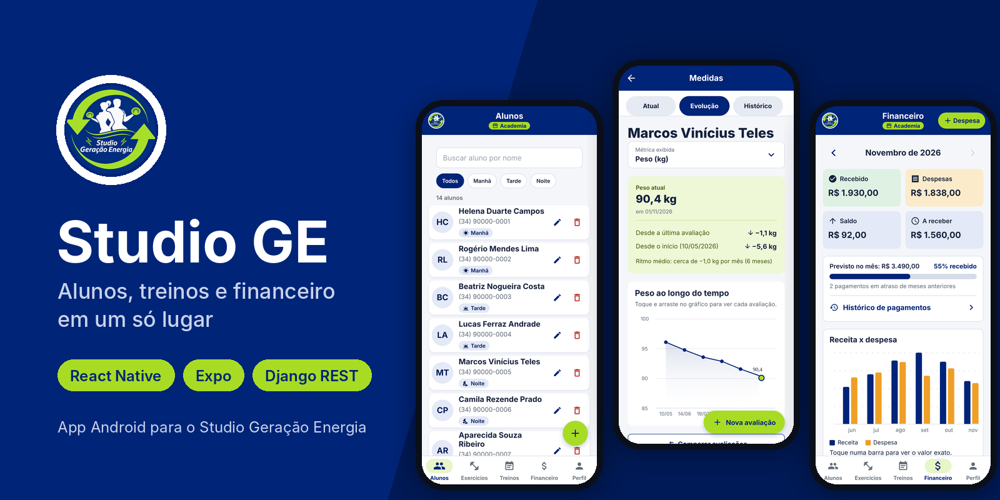
</p>

<p align="center">
  
  
  
  
  
  
</p>

<p align="center">
  App Android de gestão para o <b>Studio Geração Energia</b>, feito para o dono e instrutor do studio:<br>
  alunos, avaliações físicas, evolução, treinos personalizados e financeiro, tudo em um só lugar.
</p>

---

## Sumário

- [Sobre o projeto](#sobre-o-projeto)
- [Telas do app](#telas-do-app)
- [Funcionalidades](#funcionalidades)
- [Como o instrutor usa o app](#como-o-instrutor-usa-o-app)
- [Arquitetura](#arquitetura)
- [Estrutura de pastas](#estrutura-de-pastas)
- [Modelo de dados](#modelo-de-dados)
- [API](#api)
- [Tecnologias](#tecnologias)
- [Como rodar localmente](#como-rodar-localmente)
- [APK e produção](#apk-e-produção)
- [Como o projeto é desenvolvido](#como-o-projeto-é-desenvolvido)
- [Roadmap](#roadmap)
- [Autoria](#autoria)

---

## Sobre o projeto

O **Studio GE** nasceu no Projeto de Extensão do curso de Análise e Desenvolvimento de Sistemas (ADS) e foi feito para um **cliente real**: o Studio Geração Energia, um studio de treino personalizado.

A primeira ideia era um app para os alunos, com vídeos, cronômetro e notificações. Depois da **entrevista com o dono do studio**, ficou claro que o problema dele era outro: organizar alunos, medidas, treinos e mensalidades que hoje ficam espalhados em papel, planilhas e anotações. Por isso o app passou a ser **de uso exclusivo do instrutor**.

Princípios que guiaram o projeto:

- **Simples para quem não é da área de tecnologia:** poucos passos por tela, textos sem jargão e botões grandes, com área de toque de no mínimo 44px.
- **O app calcula, o instrutor não digita:** IMC, variações de medida, status de pagamento, saldo e inadimplência são sempre calculados.
- **A cor nunca trabalha sozinha:** todo estado (pago, atrasado, turno, categoria) tem também ícone e texto.

> As telas abaixo usam **dados fictícios** gerados pelo comando `seed_demo`. Nenhum dado real de aluno aparece no repositório.

---

## Telas do app

### Alunos e avaliações físicas

<table>
  <tr>
    <td align="center" width="25%">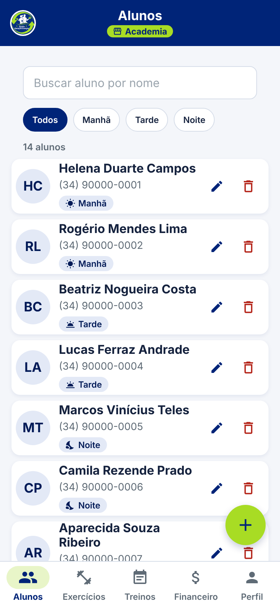<br><b>Alunos</b><br><sub>Busca por nome, filtro por turno e contagem</sub></td>
    <td align="center" width="25%">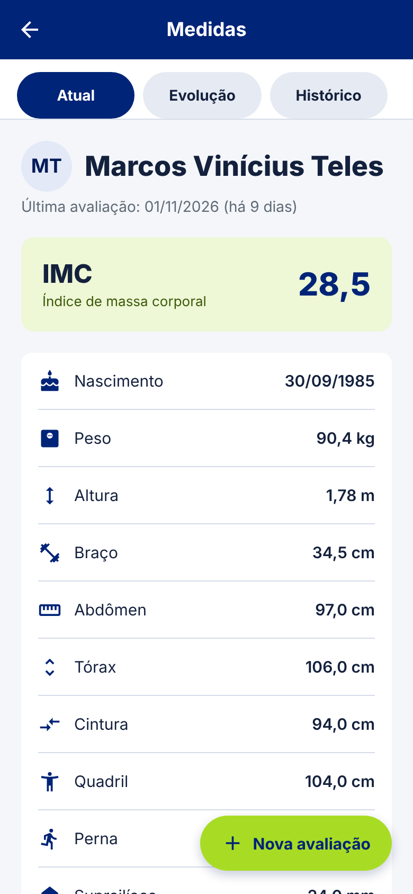<br><b>Avaliação atual</b><br><sub>IMC calculado e quanto tempo faz desde a última avaliação</sub></td>
    <td align="center" width="25%">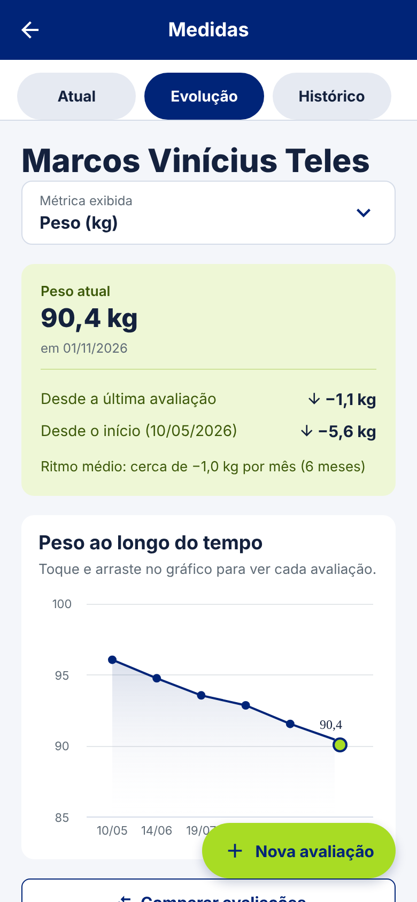<br><b>Evolução</b><br><sub>Gráfico por métrica, variação e ritmo médio por mês</sub></td>
    <td align="center" width="25%">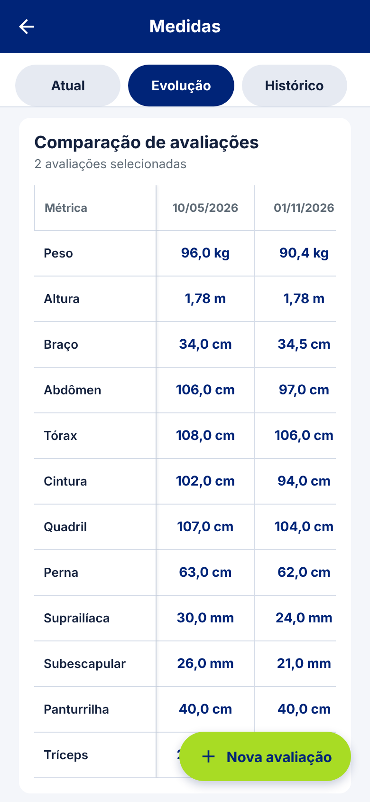<br><b>Comparação</b><br><sub>Tabela com as avaliações escolhidas lado a lado</sub></td>
  </tr>
  <tr>
    <td align="center">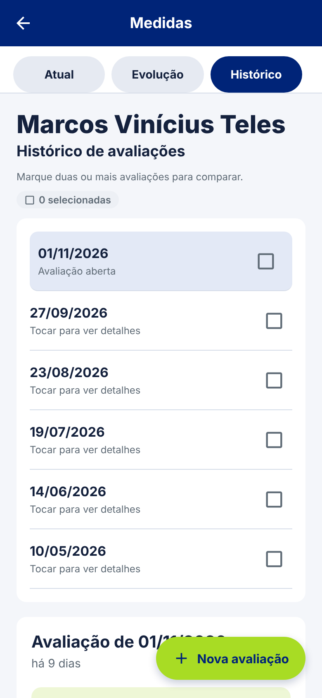<br><b>Histórico</b><br><sub>Todas as avaliações; marque duas ou mais para comparar</sub></td>
    <td align="center">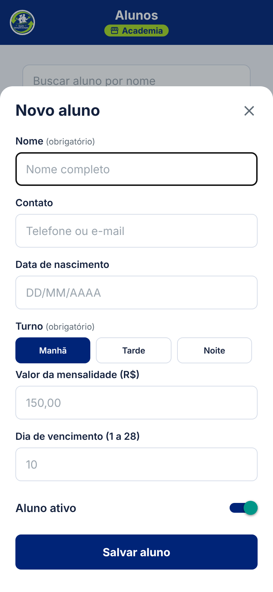<br><b>Novo aluno</b><br><sub>Turno, mensalidade e dia de vencimento</sub></td>
    <td align="center">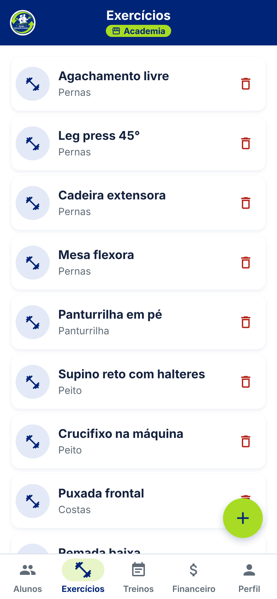<br><b>Exercícios</b><br><sub>Catálogo da academia por grupo muscular</sub></td>
    <td align="center">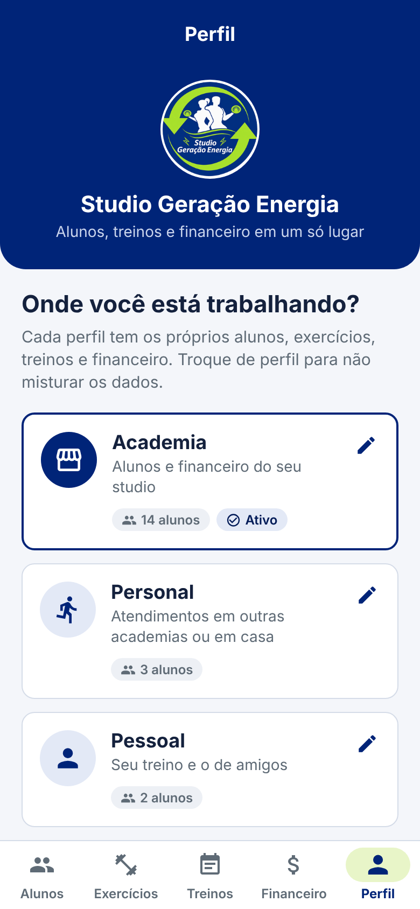<br><b>Perfis</b><br><sub>Academia, Personal e Pessoal, cada um com seus dados</sub></td>
  </tr>
</table>

### Treinos e financeiro

<table>
  <tr>
    <td align="center" width="25%">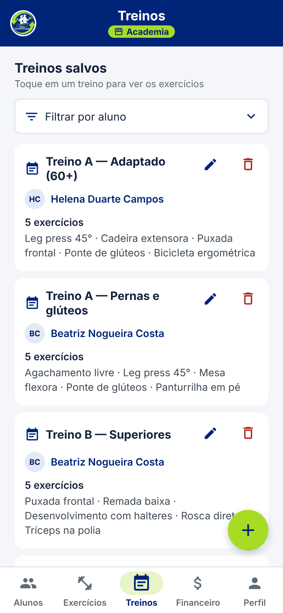<br><b>Treinos</b><br><sub>Filtro por aluno e resumo de cada treino</sub></td>
    <td align="center" width="25%">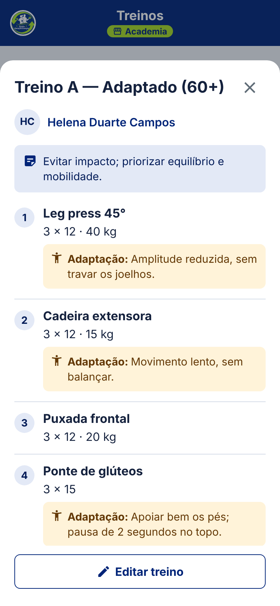<br><b>Ver treino</b><br><sub>Séries, repetições, carga e adaptações em destaque</sub></td>
    <td align="center" width="25%">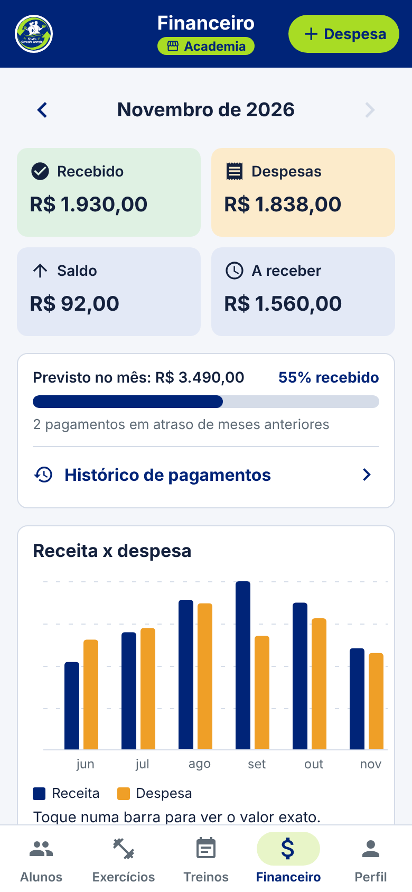<br><b>Financeiro</b><br><sub>Recebido, despesas, saldo e gráfico de 6 meses</sub></td>
    <td align="center" width="25%"><br><b>Pendências</b><br><sub>Atrasados primeiro, marcar como pago em um toque</sub></td>
  </tr>
</table>

---

## Funcionalidades

### 👥 Alunos
- Cadastro com contato, data de nascimento, turno (manhã, tarde, noite), mensalidade e dia de vencimento
- Busca por nome e filtro por turno, com contagem ("3 de 14 alunos")
- Aluno ativo ou inativo: inativos deixam de ser cobrados

### 📏 Avaliações e evolução
- 12 métricas por avaliação: peso, altura, circunferências (braço, abdômen, tórax, cintura, quadril, perna, panturrilha) e dobras cutâneas (suprailíaca, subescapular, tríceps)
- **IMC calculado automaticamente**
- Tela do aluno com três abas:
  - **Atual:** a avaliação mais recente e há quanto tempo ela foi feita
  - **Evolução:** gráfico de uma métrica por vez (escolhida num seletor agrupado por categoria), com a variação desde a última avaliação, desde a primeira e o ritmo médio por mês
  - **Histórico:** todas as avaliações, agrupadas em pastas por ano quando há mais de um ano
- **Tabela comparativa configurável:** o instrutor escolhe quais avaliações viram colunas (início, meio e fim de um ciclo, por exemplo) e quais métricas viram linhas

### 🏋️ Exercícios e treinos
- Catálogo de exercícios por grupo muscular
- Montagem do treino de cada aluno com séries, repetições e carga
- **Adaptação por exercício** (ex.: "amplitude reduzida, sem travar os joelhos"), mostrada em destaque
- Visualização do treino em letra maior, só para leitura, e edição num painel por cima da lista

### 💰 Financeiro
- Geração automática das mensalidades do mês para os alunos ativos
- Marcar como pago e desfazer
- Status calculado (pago, a vencer, atrasado) e dias de atraso
- Despesas por categoria (aluguel, energia e água, salários, equipamentos, manutenção, marketing, outros)
- Resumo do mês: recebido, despesas, saldo, a receber, percentual recebido e inadimplência
- Gráfico de receita x despesa dos últimos 6 meses e navegação entre meses
- O app **não processa pagamentos** e não guarda dados bancários: ele só registra as marcações do instrutor

### 🗂️ Perfis de trabalho
- Três perfis fixos: **Academia** (o studio), **Personal** (atendimentos em outros lugares) e **Pessoal** (o próprio treino e o de amigos)
- Cada perfil tem os próprios alunos, exercícios, treinos e financeiro, sem misturar dados
- O perfil ativo aparece sempre no cabeçalho, e o app lembra o último perfil escolhido

---

## Como o instrutor usa o app

```
1. Escolhe o perfil            →  Academia, Personal ou Pessoal (aba Perfil)
2. Cadastra o aluno            →  turno, mensalidade e vencimento
3. Registra a avaliação        →  medidas do dia; o IMC sai sozinho
4. Acompanha a evolução        →  gráfico por métrica e comparação entre avaliações
5. Monta o treino              →  exercícios do catálogo + séries, repetições, carga e adaptações
6. Fecha o mês no Financeiro   →  marca quem pagou, lança despesas e vê o saldo
```

---

## Arquitetura

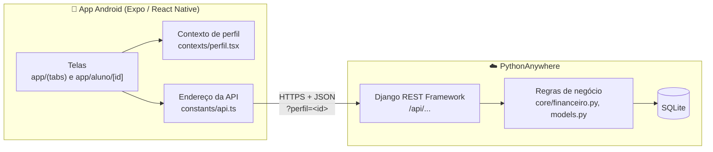

- O **app** consome a API REST. O endereço é decidido em um único arquivo (`constants/api.ts`): o APK sempre usa a nuvem, e em desenvolvimento ele usa o backend do próprio computador.
- O **backend** guarda as regras: cálculo de IMC, status de mensalidade, resumo financeiro e separação por perfil (`?perfil=<id>`).
- Valores em dinheiro usam `DecimalField` de ponta a ponta, para as somas fecharem no centavo.

---

## Estrutura de pastas

```
Studio-GE/
├── backend/                        # API em Django + Django REST Framework
│   ├── config/                     # Configurações do projeto (settings, urls, wsgi)
│   │   └── settings.py             # Separa desenvolvimento e produção por variável de ambiente
│   ├── core/                       # App principal
│   │   ├── models.py               # Perfil, Aluno, Medida, Exercicio, Treino, ItemTreino, Mensalidade, Despesa
│   │   ├── serializers.py          # Conversão entre models e JSON
│   │   ├── views.py                # ViewSets e endpoints do financeiro
│   │   ├── urls.py                 # Rotas da API
│   │   ├── financeiro.py           # Regras do resumo mensal e da geração de mensalidades
│   │   ├── admin.py                # Painel administrativo do Django
│   │   ├── tests.py                # Testes automatizados da API
│   │   ├── migrations/             # Histórico do banco de dados
│   │   └── management/commands/
│   │       └── seed_demo.py        # Cria dados fictícios de demonstração
│   ├── manage.py
│   └── requirements.txt
│
├── mobile/                         # App em React Native + Expo
│   ├── app/                        # Telas (rotas por arquivo, expo-router)
│   │   ├── _layout.tsx             # Layout raiz e provedor de perfil
│   │   ├── (tabs)/                 # Barra inferior
│   │   │   ├── index.tsx           # Alunos
│   │   │   ├── exercicios.tsx      # Exercícios
│   │   │   ├── treinos.tsx         # Treinos
│   │   │   ├── financeiro.tsx      # Financeiro
│   │   │   └── perfil.tsx          # Perfis de trabalho
│   │   └── aluno/[id].tsx          # Tela do aluno: Atual, Evolução e Histórico
│   ├── components/                 # Peças reaproveitadas
│   │   ├── tab-bar.tsx             # Barra de abas personalizada
│   │   ├── header-title.tsx        # Cabeçalho com logo e selo do perfil
│   │   ├── brand-logo.tsx          # Logo do studio
│   │   ├── fab.tsx                 # Botão flutuante (redondo ou com texto)
│   │   ├── tag.tsx                 # Etiqueta com ícone + texto
│   │   ├── avatar.tsx              # Círculo com as iniciais do aluno
│   │   ├── empty-state.tsx         # Estado vazio com convite para agir
│   │   ├── date-input.tsx          # Campo de data DD/MM/AAAA
│   │   ├── motion.tsx              # Animações leves
│   │   └── pressable-scale.tsx     # Botão que "afunda" ao toque
│   ├── contexts/perfil.tsx         # Perfil ativo, lembrado entre aberturas do app
│   ├── constants/
│   │   ├── api.ts                  # Único lugar com o endereço do backend
│   │   └── ui.ts                   # Cores, raios, espaçamentos, sombras e animações
│   ├── utils/date.ts               # Formatação de datas
│   ├── assets/images/              # Logo, ícone do app e tela de abertura
│   ├── app.json                    # Nome, versão e identidade do app
│   └── eas.json                    # Perfis de build do APK
│
├── specs/                          # Uma spec por funcionalidade (o QUÊ, nunca o COMO)
├── docs/                           # Escopo, persona, requisitos e prints do README
│   └── screenshots/
└── CLAUDE.md                       # Regras de trabalho do projeto
```

---

## Modelo de dados

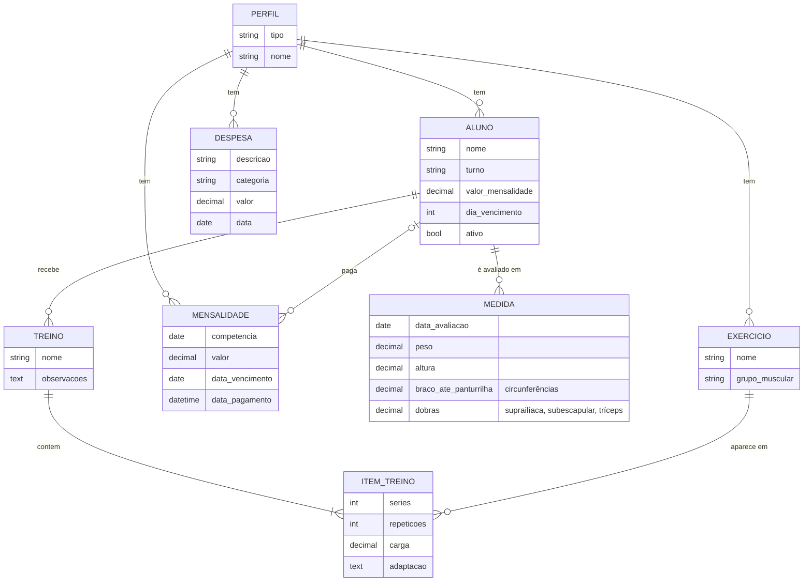

- A mensalidade guarda o **nome do aluno e o próprio perfil**: se o aluno for excluído ou mudar de valor, o histórico financeiro continua correto.
- IMC, status (`pago`, `pendente`, `atrasado`) e dias de atraso são **propriedades calculadas**, não colunas do banco.

---

## API

Base: `/api/`. As listas e o resumo aceitam `?perfil=<id>`; sem ele, vale o perfil Academia.

| Método | Rota | Descrição |
|---|---|---|
| `GET` `PATCH` | `perfis/` | Lista os três perfis com o total de alunos; `PATCH perfis/<id>/` renomeia |
| `GET` `POST` `PUT` `DELETE` | `alunos/` | Alunos do perfil |
| `GET` `POST` `PUT` `DELETE` | `medidas/` | Avaliações (`?aluno=<id>` traz todas as de um aluno) |
| `GET` `POST` `PUT` `DELETE` | `exercicios/` | Catálogo de exercícios do perfil |
| `GET` `POST` `PUT` `DELETE` | `treinos/` · `itens-treino/` | Treinos e seus exercícios |
| `GET` | `mensalidades/` | Cobranças (`?mes=AAAA-MM`) |
| `POST` | `mensalidades/<id>/pagar/` · `mensalidades/<id>/desfazer-pagamento/` | Marca ou desfaz o pagamento |
| `GET` `POST` `PUT` `DELETE` | `despesas/` | Despesas do studio |
| `POST` | `financeiro/gerar-mensalidades/` | Gera as mensalidades do mês para os alunos ativos |
| `GET` | `financeiro/resumo/` | Resumo do mês, pendências e série dos últimos 6 meses |

---

## Tecnologias

| Camada | Tecnologias |
|---|---|
| **Mobile** | React Native 0.81, Expo SDK 54, expo-router, TypeScript, react-native-gifted-charts, Reanimated, AsyncStorage |
| **Backend** | Python, Django, Django REST Framework, django-cors-headers |
| **Banco de dados** | SQLite |
| **Build e deploy** | EAS Build (APK), PythonAnywhere (backend) |
| **Ferramentas** | VS Code, GitHub Copilot, Git e GitHub |

---

## Como rodar localmente

**Pré-requisitos:** Python 3, Node.js (LTS) e o app **Expo Go** no celular (ou um emulador Android).

### 1. Backend

```bash
cd backend
python -m venv venv

# Windows
venv\Scripts\activate
# Linux / macOS
source venv/bin/activate

pip install -r requirements.txt
python manage.py migrate
python manage.py seed_demo          # opcional: dados fictícios para ver todas as telas
python manage.py runserver 0.0.0.0:8000
```

O `seed_demo` pode ser repetido sem duplicar nada e só mexe nos dados que ele mesmo cria. Para remover esses dados, use `python manage.py seed_demo --limpar`.

### 2. Mobile

Em outro terminal:

```bash
cd mobile
npm install
npx expo start
```

Escaneie o QR code com o Expo Go. O celular precisa estar na **mesma rede Wi-Fi** do computador.

| Ambiente | Endereço da API usado |
|---|---|
| APK / build de distribuição | Sempre a nuvem: `https://studioge.pythonanywhere.com/api` |
| Desenvolvimento (Expo Go, emulador, web) | O backend do mesmo computador, na porta 8000, descoberto sozinho |
| Desenvolvimento apontando para a nuvem | Defina `EXPO_PUBLIC_API_URL` em `mobile/.env.local` |

### 3. Testes

```bash
cd backend
python manage.py test
```

---

## APK e produção

**Gerar o APK** (instalável direto no celular, sem loja):

```bash
cd mobile
eas build -p android --profile preview
```

**Backend na nuvem:** o Django entra em modo produção quando existe a variável `DJANGO_SECRET_KEY`. Nesse modo o `DEBUG` fica desligado, só os endereços de `DJANGO_ALLOWED_HOSTS` são aceitos e o CORS deixa de liberar todas as origens.

| Variável | Para que serve |
|---|---|
| `DJANGO_SECRET_KEY` | Chave secreta do Django (nunca versionada) |
| `DJANGO_ALLOWED_HOSTS` | Endereços aceitos, separados por vírgula. Ex.: `studioge.pythonanywhere.com` |

O fuso é `America/Sao_Paulo`, porque o financeiro usa a data de "hoje" para marcar pagamentos e calcular atrasos.

---

## Como o projeto é desenvolvido

O projeto segue **Spec-Driven Development (SDD)**: nenhuma funcionalidade é implementada sem uma spec em [`specs/`](specs/).

```
Decisão de arquitetura  →  Spec (o QUÊ + critérios de aceite)  →  Implementação em camadas
                                                                  model → migration → admin → API → mobile
```

**Convenções principais** (detalhes em [`CLAUDE.md`](CLAUDE.md) e [`specs/identidade-visual.md`](specs/identidade-visual.md)):

- Dinheiro sempre em `DecimalField`, nunca `float`
- Valores derivados (IMC, saldo, status) são calculados, nunca digitados
- Cores e espaçamentos centralizados em `mobile/constants/ui.ts`
- Áreas de toque de no mínimo 44px e contraste WCAG AA
- Nunca versionar `SECRET_KEY`, `.env` ou `db.sqlite3`

**Identidade visual**, tirada do logo do studio:

| Marinho | Limão | Âmbar | Fundo |
|:---:|:---:|:---:|:---:|
|  |  |  |  |
| Cabeçalhos e botões | Destaques (sempre com texto marinho) | Só para "atenção" | Telas |

**Documentação:**

| Arquivo | Conteúdo |
|---|---|
| [`docs/escopo.md`](docs/escopo.md) | Objetivo, funcionalidades e o que ficou de fora |
| [`docs/persona.md`](docs/persona.md) | Quem usa o app e o que precisa dele |
| [`docs/requisitos-financeiro.md`](docs/requisitos-financeiro.md) | Requisitos do módulo financeiro |
| [`docs/ajustes-finais-v012.md`](docs/ajustes-finais-v012.md) | Ajustes combinados para a versão 0.1.2 |
| [`specs/`](specs/) | Uma spec por funcionalidade: alunos, medidas, evolução, treinos, financeiro, perfis, identidade visual, APK e nuvem |

---

## Roadmap

- [x] Cadastro de alunos, busca e filtro por turno
- [x] Avaliações físicas, IMC, gráfico de evolução e tabela comparativa
- [x] Catálogo de exercícios e treinos com adaptações
- [x] Módulo financeiro com mensalidades, despesas e resumo mensal
- [x] Perfis de trabalho (Academia, Personal, Pessoal)
- [x] Identidade visual do studio, backend na nuvem e APK de teste
- [ ] **Login na API**, obrigatório antes de usar dados reais de alunos
- [ ] Atualizações automáticas com EAS Update
- [ ] Publicação na Play Store

**Fora do escopo:** acesso do aluno ao app, vídeos de exercícios, notificações, cronômetro de descanso e processamento real de pagamentos (Pix, cartão, boleto).

---

## Autoria

Desenvolvido por **Gustavo Izidoro Barboza Oliveira** (ADS, UniPac Uberlândia) para o **Studio Geração Energia**, como Projeto de Extensão.
